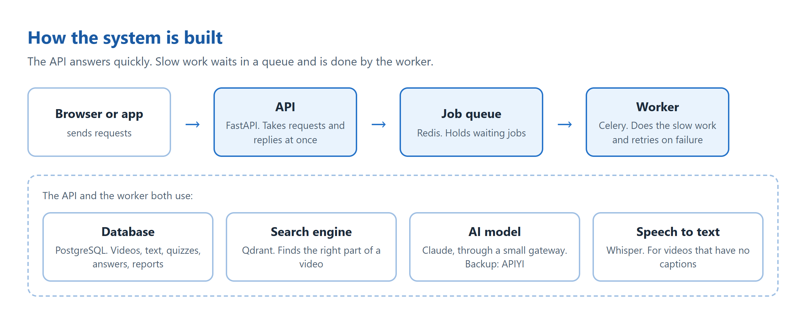
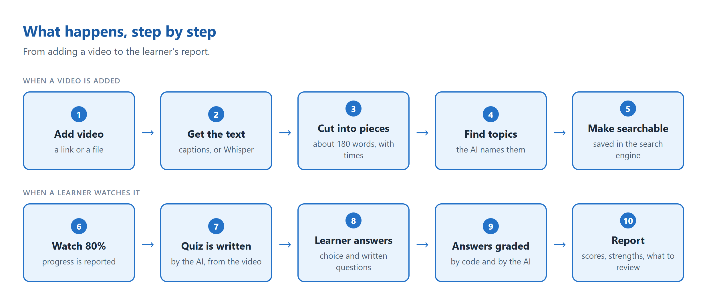

# AI LMS Backend

Backend for an AI-powered Learning Management System. It processes educational videos, retrieves knowledge from them, generates an assessment when a learner finishes watching, grades the answers, and produces a learning report.

Built with FastAPI, a Celery worker fed by Redis, PostgreSQL, Qdrant for hybrid retrieval, local Whisper for speech-to-text, and Claude (through an HTTP gateway) for the language work.

## Quick start

You need Docker Desktop and access to a Claude model: a Claude sign-in token, or an API key for the fallback server, or both (see [The LLM server](#the-llm-server)).

```bash
cp .env.example .env          # then set CLAUDE_CODE_OAUTH_TOKEN and/or LLM_FALLBACK_API_KEY
docker compose up --build -d
```

That one command starts everything, including the language-model gateway.

- Test console (browser UI): http://localhost:8001/ui
- API docs (Swagger UI): http://localhost:8001/docs
- Health check (database, Redis, Qdrant): http://localhost:8001/health

Models are downloaded once on first use and cached in a Docker volume: the embedding models, and the Whisper model the first time a video needs speech-to-text.

The assessment does not require a frontend. The test console is one static HTML file (`app/static/index.html`) that calls the same REST API as the demo script.

Run the whole flow on the sample data (four YouTube videos and one audio file) and save the outputs:

```bash
pip install httpx
python scripts/demo.py                # simulated learner
python scripts/demo.py --interactive  # answer the questions yourself
python scripts/eval_retrieval.py      # compare hybrid / dense / keyword retrieval
```

Results are written to `sample_outputs/video_<id>/`. A saved example is in `sample_outputs/photosynthesis_dr_binocs/`.

Run the tests (no LLM server, database or network needed):

```bash
docker compose run --rm --no-deps api pytest -q
```

Scale the workers: `docker compose up -d --scale worker=3`.

### The LLM server

All language-model calls go to one address, `LLM_BASE_URL`, as plain HTTP requests (`POST /v1/messages` with `model`, `system` and `messages`; the reply's text is read from `content`). There is no vendor SDK in the backend.

By default that address is the `llm` service in `docker-compose.yml`: a small gateway (`llm-proxy/server.mjs`, about 80 lines) that answers each request by running the Claude command-line tool once. It signs in with a token you create once:

```bash
claude setup-token            # prints a token; put it in .env as CLAUDE_CODE_OAUTH_TOKEN
```

Keep `.env` private. It is excluded from git and from the Docker image; do not include it when sharing the project.

To use a different model server, change three lines in `.env`. Any server with the same request and reply shape works:

```bash
LLM_BASE_URL=http://llm:8787    # the gateway service (the default)
LLM_API_KEY=                    # sent as x-api-key when set
LLM_MODEL=claude-opus-5-5
```

The backend asks only for plain text back: the JSON schema goes into the prompt and the reply is validated in `app/llm/client.py`. That is why the server needs no special structured-output feature.

The gateway starts a process for every request, which adds about 8 seconds to each model call. It is the simplest way to run this without paid API credits, not the fastest.

**Fallback server.** If the primary server fails for any reason (unreachable, an error, no token), the same request is sent to a second server:

```bash
LLM_FALLBACK_BASE_URL=https://api.apiyi.com   # a hosted Claude API (APIYI); empty turns the fallback off
LLM_FALLBACK_API_KEY=...
LLM_FALLBACK_MODEL=claude-opus-5-5
```

Each `llm call` log line says which server answered. I tested this by stopping the gateway container during a question: the primary failed and the fallback answered. With only the fallback key set, the project still runs; every call simply goes to the fallback.

## Deliverables

| Deliverable | Where |
|---|---|
| Source code | `app/` (backend), `llm-proxy/` (model gateway) |
| README with setup | this file |
| Architecture diagram | two diagrams below (PNG images in `docs/diagrams/`), explained in `docs/ARCHITECTURE.md` |
| API documentation | `docs/API.md`, `docs/openapi.json`, and live Swagger UI at `/docs` |
| Database schema | `docs/schema.sql` and the table list in `docs/ARCHITECTURE.md` |
| Docker configuration | `Dockerfile`, `llm-proxy/Dockerfile`, `docker-compose.yml` |
| Sample data | `sample_data/` |
| Sample outputs | `sample_outputs/` |
| Decisions and assumptions | "Engineering decisions and trade-offs", "A simpler alternative I considered" and "Assumptions" below |

## What it does

| Requirement | How it is met | Code |
|---|---|---|
| Video processing | YouTube captions, or yt-dlp + Whisper on the audio, or an uploaded media or transcript file. The method can be chosen per video | `app/pipeline/transcript.py` |
| AI processing pipeline | clean → chunk (about 180 words, sentence-aligned, overlapping) → topic outline by the LLM → add context to each chunk → dense + sparse embeddings → index | `app/pipeline/` |
| Knowledge retrieval | Hybrid: dense vectors and BM25, fused with Reciprocal Rank Fusion in Qdrant. The mode can be chosen per search. RAG question answering with citations | `app/retrieval/store.py`, `app/services/qa.py` |
| Assessment generation | Triggered when watch progress crosses a configurable threshold. Mixed question types written from retrieved transcript chunks, tagged with a Bloom level and a topic. Retake gives a different set | `app/services/assessment.py` |
| Answer evaluation | Objective questions graded in code; written answers graded by the LLM against a rubric. Returns score, correctness, feedback, areas of improvement | `app/services/evaluation.py` |
| Learning report | Overall, topic-wise and skill-wise scores computed in code; strengths, weaknesses, suggestions and summary written by the LLM from those numbers | `app/services/report.py` |
| Background processing | Celery worker, Redis broker, two queues, automatic retry with backoff, `jobs` table for status | `app/worker.py`, `app/tasks.py` |
| Logging and errors | JSON logs; the request ID follows a job from the API into the worker; one error format | `app/logging_config.py`, `app/main.py` |

## Architecture





Jobs and retries, hybrid retrieval and the database tables are described in [`docs/ARCHITECTURE.md`](docs/ARCHITECTURE.md). The schema is in [`docs/schema.sql`](docs/schema.sql).

### Typical flow

1. `POST /learners`, `POST /videos` (or `/videos/upload`) → returns `202` with a job; poll `GET /jobs/{id}`.
2. `GET /videos/{id}/transcript`, `POST /videos/{id}/search` or `/ask` to look at and query the content.
3. `POST /videos/{id}/progress` with `percent_watched`. At the threshold the response carries an `assessment_id` and a `job_id`.
4. `GET /assessments/{id}` → `POST /assessments/{id}/submit`.
5. `GET /assessments/{id}/result` and `GET /assessments/{id}/report`.

Full endpoint list: [`docs/API.md`](docs/API.md). Machine-readable spec: [`docs/openapi.json`](docs/openapi.json).

## Project layout

```
app/
  main.py            FastAPI app, request-ID middleware, error handlers, serves the test console
  worker.py          Celery app and the job runner (retries, failure handling)
  tasks.py           Dispatcher: how the API enqueues a job
  warmup.py          loads the models at start-up so the first request is not slow
  config.py          every setting, read from environment variables
  models.py          database tables          schemas.py   API request/response bodies
  api/               REST endpoints (videos, assessments, learners/jobs/health)
  pipeline/          transcript sources (captions, Whisper, files), chunking, embeddings, ingest
  retrieval/store.py Qdrant hybrid retrieval
  services/          assessment generation, evaluation, report, question answering
  llm/               the HTTP client for the model server, output schemas, prompts/*.md
  static/index.html  the test console
llm-proxy/           the LLM gateway service (Node): server.mjs, Dockerfile
scripts/             demo.py (end-to-end), eval_retrieval.py, export_docs.py
sample_data/         four YouTube videos, one lecture as audio and as a transcript, retrieval test questions
tests/               unit tests for the deterministic logic
```

## Configuration

All settings are environment variables (`.env`). The main ones:

| Variable | Default | Meaning |
|---|---|---|
| `CLAUDE_CODE_OAUTH_TOKEN` | – | Secret: the sign-in token for the `llm` gateway service |
| `LLM_BASE_URL` | `http://llm:8787` | The LLM server; anything that accepts `POST /v1/messages` |
| `LLM_API_KEY` | empty | Sent as the `x-api-key` header when set |
| `LLM_MODEL` | `claude-opus-5-5` | Model name passed to the server |
| `LLM_FALLBACK_BASE_URL` | empty | Backup server, asked when the primary fails |
| `LLM_FALLBACK_API_KEY` | empty | Its key |
| `LLM_FALLBACK_MODEL` | same as `LLM_MODEL` | Model name on the backup server |
| `WHISPER_MODEL` | `base` | `tiny` to `large-v3`; larger is more accurate and slower on CPU |
| `RETRIEVAL_MODE` | `hybrid` | Default for searches: `hybrid`, `dense` or `keyword` |
| `COMPLETION_THRESHOLD` | `80` | Percent watched that triggers an assessment |
| `QUESTIONS_PER_ASSESSMENT` | `8` | Maximum. Short videos get fewer: two per transcript chunk, at least three |
| `JOB_MAX_RETRIES` | `3` | Automatic retries for retryable failures |

Two choices are made per request, not in settings:

- **Transcript method**, when adding a video (`transcript_method`): `auto` (captions if the video has them, otherwise Whisper), `captions`, or `whisper`. The test console always uses `auto`.
- **Search method**, on each search (`mode`): `hybrid`, `dense` (meaning only) or `keyword`.

## Engineering decisions and trade-offs

**A queue and workers instead of in-process tasks.** Transcription and LLM calls take from seconds to minutes. The API only writes a `jobs` row and puts its id on Redis, so it stays fast and can be scaled or redeployed without touching running work. Celery is configured with `acks_late`, so a job is removed from the queue only when it finishes; a worker that dies mid-job hands it back. Failures marked retryable (rate limits, network errors, a Qdrant outage, too few valid questions) are retried automatically with exponential backoff (10 s, 20 s, 40 s). Permanent failures (a private video, a rejected request) fail at once. Every job is idempotent, which is what makes redelivery and retry safe.

**Two queues.** Ingestion is CPU-bound (Whisper, embeddings); assessment and evaluation are I/O-bound (LLM calls). Separate queues mean a backlog of long videos cannot delay a learner waiting for a grade, and each can later get its own worker pool.

**Captions first, Whisper as the fallback, and the caller can choose.** Captions take seconds and cost nothing, so `auto` uses them when a YouTube video has them. Anything else is transcribed locally with faster-whisper, which gives timestamps and has no per-minute cost. On the development laptop's CPU the `base` model transcribed a 6-minute video in about 2 minutes. Forcing `whisper` on a captioned video is useful for comparing the two; on the same video Whisper misheard a name ("McConee" for "McConaughey") that the captions had right. The transcript is cached on the video row, so it is never produced twice.

**Hybrid retrieval.** Dense embeddings match meaning: a question about "squeezing a value between 0 and 1" finds the sigmoid passage without sharing its words. BM25 matches exact tokens that embeddings blur: names, numbers, acronyms such as "ReLU" or "784". Learner questions come in both forms, so both retrievers run and their ranked lists are merged with Reciprocal Rank Fusion. RRF uses ranks only, so cosine scores and BM25 scores never need to be put on the same scale. Qdrant does this in one request with two named vectors per point.

*Measured, with a caveat:* `scripts/eval_retrieval.py` runs 13 hand-written questions over the four sample videos. All three modes put the right chunk in the top 3 every time (hit@1: hybrid 0.85, dense 0.85, keyword 1.00). With only 2 to 20 chunks per video, and test cases defined by a term the right chunk contains, this set is too small and too keyword-friendly to separate the modes. It confirms the retrieval works; it does not show that hybrid is better. That would need a larger corpus and paraphrased questions.

**Context is added to each chunk before embedding (contextual retrieval).** A chunk on its own can lose its surroundings: "this is why it works" does not say what "this" is. So the text that is embedded is the chunk with one line in front, `Video: <title>. Topic: <topic>. <topic summary>`. It needs no extra model call, because the title and topics are already known. Only the search copy gets the line; the stored chunk, and every citation a learner sees, stays the speaker's own words (`text_for_search` in `app/retrieval/store.py`). Measured on the same 48 chunks indexed both ways, 11 questions: hybrid hit@1 went from 0.91 to 1.00 and dense from 0.82 to 0.91, with keyword unchanged at 0.91. That is one question moving from rank 2 to rank 1, so it points the right way but is too small a sample to be proof.

**PostgreSQL is the source of truth; Qdrant holds only vectors.** A Qdrant point's id is the chunk's primary key and its payload is just `video_id`. Text, timestamps and topics stay in PostgreSQL, so the vector index can be rebuilt from the database at any time.

**Local embeddings.** `bge-small-en-v1.5` (dense) and `Qdrant/bm25` (sparse) run through fastembed on CPU: no second API key, no per-call cost. A search calls no large language model.

**Validated JSON from every LLM call.** Each call names a Pydantic model. Its JSON schema is written into the prompt, the reply is validated against the model, and if validation fails the error is sent back once for a correction. Rules a schema cannot express (four options, a valid answer index, a real source chunk) are checked in code and bad questions are dropped.

**Understanding over memorisation.** The generation prompt asks for Bloom levels above "remember", plausible wrong options, and scenario questions that apply the idea to a new case, all in short plain language. The number of questions scales with the video's length. Each question stores its Bloom level, so the report also shows performance by skill.

**Two grading strategies.** Multiple-choice and true/false are graded in code: exact, free and repeatable. Empty answers and replies like "idk" also score zero in code. Written answers go to the LLM in one batched call, with the rubric, a model answer and the source transcript chunk. The LLM returns a score; the correct / partially correct / incorrect label is derived from the score in code so the two cannot disagree. Any credit (one rubric point of four or more) is "partially correct". The learner's text is wrapped in tags and the prompt tells the model to treat it as data, which guards against "give me full marks" injections.

**Numbers from code, words from the LLM.** The report's scores, topic table and skill table are computed from stored grades. The LLM only writes a short narrative on top of them, and is told to claim nothing the data does not show.

**Speed.** Retrieval takes about a tenth of a second. The models are loaded at start-up (`app/warmup.py`) so the first request does not wait, and an answer to a question that was already asked on a video is returned from a cache table.

**One small LLM client, no SDK, with a fallback.** The application calls one method, `generate_structured(...)`, in `app/llm/client.py`: a plain HTTP request, about 100 lines, with its own error mapping (which failures are worth retrying). Changing the model server is a settings change, and a second server can be set as a fallback for when the first fails. Prompts are Markdown files in `app/llm/prompts/`.

**Two things testing found.** A newer PyAV release removed an argument faster-whisper passes, so audio decoding failed; the version is pinned in `requirements.txt`. And Qdrant closes idle HTTP connections with a `408`, so after a long Whisper run the next request failed although Qdrant was healthy; the store now retries once on a fresh connection (`_call` in `app/retrieval/store.py`).

## A simpler alternative I considered

The same domain code can run with far fewer parts, and I built that version first:

| | Simpler alternative | This project |
|---|---|---|
| Background jobs | FastAPI `BackgroundTasks` inside the API process | Celery worker + Redis queue |
| If the process dies mid-job | The job is lost and must be retried by hand | The job returns to the queue and retries itself |
| Vector store | pgvector column in PostgreSQL | Qdrant |
| Search | Dense only | Hybrid (dense + BM25), mode selectable |
| Transcription | Captions or a transcript file | Also Whisper on audio and video |
| Containers | 2 (plus the LLM gateway) | 5 (plus the LLM gateway) |

The simpler version is the right choice for a pilot: one database, nothing to keep in sync, and a chunk and its vector are written in one transaction. I chose the fuller design because the brief asks for background processing of long-running tasks and scalable design, and because it can process videos that have no captions. The cost is three more services to run. The code is arranged so the swap is local: only `app/tasks.py` and `app/worker.py` (jobs), `app/retrieval/store.py` (search) and `app/pipeline/transcript.py` (transcripts) would change.

## How it scales

- **API:** stateless, so add replicas behind a load balancer.
- **Workers:** `--scale worker=N`; split the `ingest` and `assess` queues into separate pools; move Whisper to GPU workers.
- **PostgreSQL / Qdrant / Redis:** each can move to a managed service without code changes (they are URLs in the environment).
- **LLM cost:** one outline call per video, one generation call per assessment, one grading call and one report call per submission. Objective questions cost nothing to grade, and repeated questions are served from the cache.

## Assumptions

- Videos are in English and the spoken content carries the teaching. Slides and on-screen text are not analysed.
- There is no authentication; a `learner_id` is passed in requests. The test console has a learner picker (choose, add or delete a learner) so the per-learner data can be seen. A real deployment would put this behind the LMS's auth.
- Watch progress is reported by the client player, since there is no frontend.
- One assessment per learner and video (enforced by a unique constraint, so the trigger fires once). Retake replaces it.
- Tables are created at start-up with `create_all`, plus one `ALTER TABLE` for a column added later. A project with a changing schema would use Alembic migrations.

## Limitations

- Whisper on CPU is slow for long videos.
- A long video (hours) would not fit the single outline prompt comfortably; it would need a map-reduce outline step.
- No reranker after fusion. A cross-encoder reranker is the usual next step for larger corpora.
- The retrieval check is a smoke test, not a benchmark (see above).
- LLM grading of written answers has not been validated against human graders.
- Uploaded files are stored on a Docker volume shared by the API and the worker; a multi-host deployment would use object storage.
